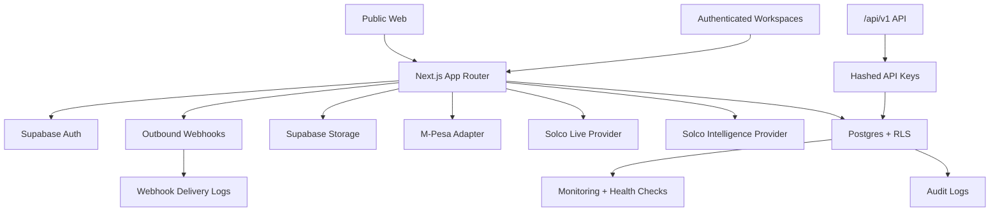

# Solva Academy Architecture

## Tenant Model

Users hold one identity and multiple scoped capabilities. Workspaces separate personal learning, academy, organization, and platform administration contexts. Tenant data is scoped with workspace, academy, organization, course, and owner identifiers, then protected by server-side authorization and RLS.

## Integration Model

Integrations are recorded in the integration directory with explicit status values. Unverified providers remain `coming_later` or `available`, not `connected`.

## Public API Model

Public APIs are versioned under `/api/v1`, require hashed API keys, enforce scopes, log usage, rate-limit requests, and avoid exposing raw database structures.
